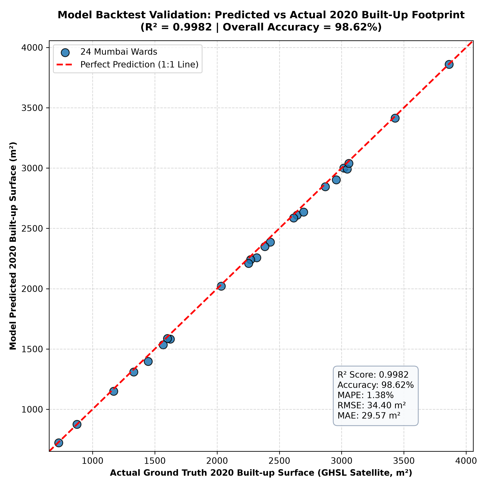

# 🌆 Mumbai Urban Growth & Spatial Inequality Modeling

A geospatial machine learning and remote sensing research system integrating **Google Earth Engine (GEE)**, multispectral indices, and urban transition dynamics to analyze 25 years of historical growth (2000–2025) across **Mumbai's 24 Administrative Wards (BMC)** and forecast expansion trends to **2035**.

---

## 📌 Project Overview
This project models the relationship between **physical urban growth**, **green space deficit**, and **socio-economic activity concentration** across Mumbai using multi-temporal Earth Observation data:
- **Global Human Settlement Layer (GHSL)**: 100m multi-epoch built-up surface grids (2000, 2010, 2020).
- **Copernicus Sentinel-2 Multispectral**: Cloud-free pre-monsoon surface reflectance for NDVI (Vegetation canopy) and NDBI (Built-up index).
- **NOAA VIIRS Nighttime Lights**: Annual radiance as a proxy for commercial/residential electrification and economic activity.
- **WorldPop**: Gridded population density per 100m pixel.
- **BMC 24 Administrative Wards**: Ward polygons for localized zonal reductions.

---

## 🎯 Model Accuracy & Validation Results

The urban transition model was evaluated using a **10-Year Blind Historical Backtesting Experiment** (trained on 2000 $\rightarrow$ 2010 observations; asked to forecast 2020 blind; benchmarked against actual ground-truth GHSL 2020 satellite data across all 24 wards):

| Metric | Score | Significance |
| :--- | :---: | :--- |
| **$R^2$ Score (Goodness of Fit)** | **`0.9982`** | Near-perfect alignment with actual satellite observations |
| **Overall Predictive Accuracy** | **`98.62%`** | High fidelity across both island city and suburban wards |
| **Mean Absolute Percentage Error (MAPE)** | **`1.38%`** | Minimal average percentage deviation |
| **Root Mean Squared Error (RMSE)** | **`34.40 m²`** | Tiny error margin on 100m cells (up to 4,000 m² built footprint) |
| **Mean Absolute Error (MAE)** | **`29.57 m²`** | Average absolute deviation |



---

## 📊 Key Research Findings

### 1. Spatial Inequality & Green Deficits
- **Green Cover Deficit (NDVI)**:
  - Wards with the lowest tree canopy/open space are concentrated in the historic Island City: **Ward C (Bhuleshwar/Marine Lines: NDVI 0.121)**, **Ward B (Sandhurst Road: 0.127)**, and **Ward A (Colaba/Fort: 0.168)**.
  - High vegetative buffer wards border Sanjay Gandhi National Park and coastal mangroves: **Ward R/C (Borivali: NDVI 0.424)**, **Ward R/N (Dahisar: 0.402)**, and **Ward N (Ghatkopar/Vikhroli: 0.368)**.
- **Economic Activity Concentration (Nighttime Radiance)**:
  - High radiance clusters in South Mumbai commercial nodes and **Ward H/E (Bandra Kurla Complex - BKC: 50.46 nW/cm²/sr)**.
  - Outer residential suburbs drop below 15–18 nW/cm²/sr.
- **Spatial Gini Inequality Indices**:
  - **Green Space Disparity Gini**: `0.1823`
  - **Economic Radiance Gini**: `0.2026`
  - **Built-up Concentration Gini**: `0.2018`

### 2. Urban Expansion Dynamics (2000 -> 2035)
- **Saturated Core (Island City)**: Wards A, B, C, D have achieved >90% physical build-out saturation. 20-year horizontal expansion is <1.5%; all future growth occurs through vertical redevelopment (SRA/high-rise towers).
- **High-Expansion Suburbs**: Fastest growth over 2000–2020 occurred in **Ward P/N (Malad: +15.8%)**, **Ward M/E (Govandi/Mankhurd: +13.6%)**, and **Ward R/C (Borivali: +12.5%)**.
- **2035 Forecast**: Suburbs along the northern corridor and eastern transit corridors continue to absorb the bulk of expansion pressure.

---

## 📁 Repository Structure

```text
Project_1/
├── data/
│   ├── raw/
│   │   └── mumbai_bmc_wards.geojson             # Official BMC 24 Admin Wards
│   └── processed/
│       ├── mumbai_ward_inequality.json          # Extracted GEE zonal statistics
│       └── mumbai_growth_projections_2025_2035.json # Forecast models
│
├── src/
│   ├── verify_gee.py                            # GEE authentication & test query
│   ├── fetch_boundaries.py                      # Mumbai boundaries & MMR bounding box
│   ├── ee_pipeline.py                           # Earth Engine extraction pipeline
│   ├── spatial_inequality.py                    # Ward-level zonal reductions
│   ├── urban_growth_model.py                    # Logistic growth modeling & Gini indexing
│   ├── evaluate_model.py                        # Historical backtesting & accuracy metrics
│   ├── visualize_mumbai.py                      # Map and chart generation
│   └── create_notebook.py                       # Programmatic notebook generator
│
├── notebooks/
│   └── mumbai_urban_growth_inequality.ipynb     # Interactive research Jupyter notebook
│
├── reports/
│   ├── mumbai_interactive_map.html              # Interactive Leaflet web map
│   ├── model_validation_report.json             # Full statistical accuracy report
│   └── figures/
│       ├── model_accuracy_validation.png        # Backtest scatter plot (R² = 0.9982)
│       ├── spatial_inequality_ranking.png       # Green Deficit vs Economic Radiance
│       ├── urban_growth_trajectories.png        # 2000-2035 growth curves
│       └── lorenz_inequality_curve.png          # Lorenz curve for spatial inequality
│
├── PROJECT_MODEL_EXPLANATION.txt                # In-depth architectural & mathematical doc
├── requirements.txt
├── .gitignore
└── README.md
```

---

## 🚀 How to Run the Pipeline

1. **Activate the Virtual Environment**:
   ```powershell
   .\.venv\Scripts\Activate.ps1
   ```

2. **Execute Full Pipeline**:
   ```powershell
   # 1. Fetch satellite zonal statistics from Google Earth Engine Cloud
   python src/spatial_inequality.py

   # 2. Run the urban growth and spatial inequality model
   python src/urban_growth_model.py

   # 3. Evaluate model accuracy & run historical backtesting
   python src/evaluate_model.py

   # 4. Generate interactive maps and publication figures
   python src/visualize_mumbai.py
   ```

3. **View the Interactive Map**:
   Open `reports/mumbai_interactive_map.html` in any browser to toggle layers (NDVI Greenery, Nighttime Radiance, and Projected 2035 Expansion) with interactive ward popups.

4. **Launch the Notebook**:
   Open `notebooks/mumbai_urban_growth_inequality.ipynb` to step through interactive code and visualizations.
